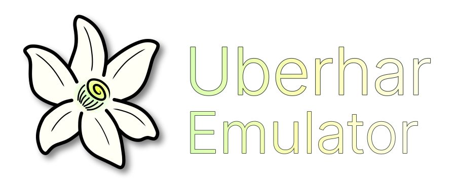

<!-- CodexAstraLocal: Present Uberhar's identity with a local, credited wordmark; keep upstream distribution and support clearly separate. -->
# Uberhar



**An experimental Azahar fork focused on Android ARM64, complete graphics and
smoother first playthroughs.** Uberhar develops alternative ways to divide 3DS
rendering between the CPU and GPU, with useful CPU parallelism and correct output
as the priorities.

[Download Uberhar](https://github.com/RegiRex/uberhar/releases) ·
[Report an issue](https://github.com/RegiRex/uberhar/issues) ·
[Build workflow](https://github.com/RegiRex/uberhar/actions/workflows/uberhar-alpha.yml) ·
[Roadmap](docs/Uberhar_Roadmap.html)

Active development is on
[`uberhar/hybrid-shaders`](https://github.com/RegiRex/uberhar/tree/uberhar/hybrid-shaders).
Use that branch for the Uberhar source and documentation.

<!-- CodexAstraLocal: State performance and correctness objectives as goals, keeping cold-cache rendering distinct from warmed benchmarks and CPU occupancy. -->
## Purpose and goals

Uberhar is for Android players testing demanding games and for contributors
working on shader compilation, rendering correctness and CPU/GPU scheduling.
Its development goals are:

- **A correct cold first playthrough:** reduce compilation hitches without
  depending on a prebuilt application shader cache or skipping draws to hide
  compilation. First-use compilation can still pause today.
- **Sustained 99% or better normal emulation speed at 2×, then 4×**, measured
  with a 100% speed limit, complete graphics and consistent frame pacing.
- **Useful adaptive CPU multicore work:** distribute independent work within the
  available CPU budget, preserve dependent work in order, and judge improvement
  by complete frames. Use additional CPU capacity when it improves sustained
  performance; earlier three/four-core targets are stepping stones, not ceilings.
  One core-equivalent means one core fully occupied over the measured interval;
  it does not require pinning work to a particular physical core.
- **Renderer choices with clear ownership:** retain CPU vertex execution where
  useful, investigate mixed rendering, and develop independent CPU graphics
  without silently substituting a different mode.

These are development targets. Native and Combo have completed device game runs,
but substantial slowdowns and visual defects remain. Local correctness checks
and successful builds do not establish playable whole-game support. Read the
notes attached to each [published release](https://github.com/RegiRex/uberhar/releases)
for its scope. The source branch may contain changes awaiting release or device
qualification.

<!-- CodexAstraLocal: Describe surviving modes and retire unsuccessful standalone experiments without implying that CPU shader preparation executes GPU fragments. -->
## Rendering modes

All modes still emulate the guest CPU on the host CPU. The table describes
**guest graphics**; the host GPU also handles display presentation.

| Mode | Where graphics work runs | Intended use and limits |
| --- | --- | --- |
| **Native** — “Virtual PICA: native rasterization” | Guest vertex shaders run on the CPU; Vulkan rasterization and fragment shading run on the GPU. Eligible CPU work can use workers. | Main CPU-vertex rendering path. Generic and ready prepared fragment shaders reduce first-use work, but compilation stalls and rendering defects remain possible. |
| **Combo** — “Virtual PICA: automatic combination” | CPU vertices combine with ready GPU vertex execution for eligible draws, Vulkan rasterization and bounded fragment specialization. | Compare mixed work placement with Native. It is not the independent compute renderer. Pending optional specialization retains a complete rendering path. |

**Custom** exposes the inherited graphics settings; it does not carry the same
preset behavior. Complete generic shaders remain an internal cold-rendering path
in Native/Combo while optional specialization becomes ready.

Choose a mode in Android's **Graphics** settings and restart the game after
changing it. The presets apply their own effective graphics settings. Native
and Combo use Vulkan. The
**Native mode** name does not mean **1× native resolution**.

<!-- CodexAstraLocal: Document the actual removal and safe legacy migration. -->
Calculated was removed in 0.1.51. Starting with 0.1.52, CPU Software and Combo
(generic fragments) are also retired from Android's selectable modes. Saved
Calculated/Software modes migrate to Native; generic Combo migrates to Combo.
The inherited software engine remains an internal reference, not an Android
performance feature. A CPU pixel switch is not included: changing its presenter
would not resolve the measured low rasterization throughput. Historical results
remain available and are not claims about selectable modes in this version.

<!-- CodexAstraLocal: Route installs to this fork and state the actual Android package/minimum SDK without borrowing upstream desktop or store qualification. -->
## Downloads and setup

1. Get the ARM64 APK from [RegiRex/uberhar releases](https://github.com/RegiRex/uberhar/releases).
   Uberhar's release assets include an APK checksum, validation records and native
   symbols. Development builds are experimental.
2. Install it on a **64-bit ARM Android device running Android 10 or newer**.
   This is the package's platform minimum, not a promise of game performance;
   the Vulkan modes also require a compatible device and driver.
3. Select an empty Uberhar data folder, or one already initialized by Uberhar.
   Its separate app ID, `org.uberhar.uberhar_emu`, allows it to coexist with Azahar.
   Copy any saves you want to use into that separate setup.
4. Select a renderer and resolution, then launch a game. Keep the version,
   renderer, resolution and settings with any compatibility report.

Uberhar's published build target is Android ARM64. Windows, macOS and Linux code
and build support are inherited from Azahar; this fork's Android qualification
does not qualify those platforms. The Google Play, Flathub and desktop downloads
in the [preserved Azahar README](docs/UPSTREAM_README_AZAHAR.md) are upstream Azahar
products.

<!-- CodexAstraLocal: Separate the owner's hardware planning targets from platform minimums and completed device qualification. -->
Performance development targets the **Retroid Pocket Duo class of hardware
(eight CPU cores and 8 GB RAM)** as its planning baseline. **Ayn Thor Max** is the
primary hardware-validation device; **Odin 3 and newer flagship hardware** are
scaling targets. These are design targets, not a completed compatibility or
performance guarantee. Worker budgets account for available CPU capacity;
heterogeneous cores, Android background work and thermals affect useful throughput.

<!-- CodexAstraLocal: Make the fork's checked-in build and validation recipes authoritative while retaining upstream platform instructions. -->
## Building and contributing

Clone this fork with its submodules:

```sh
git clone --recurse-submodules --branch uberhar/hybrid-shaders https://github.com/RegiRex/uberhar.git
cd uberhar
```

The [ARM64 workflow](.github/workflows/uberhar-alpha.yml) contains the Android
toolchain, signing and packaging recipe. It builds the `uberhar` flavor with
`assembleUberharRelease` and `-PuberharArm64Only=true`; other Android flavors
retain upstream identities. Publication depends on both the Android job and the
[shader and correctness workflow](.github/workflows/uberhar-shaders.yml), followed
by package, checksum and signature validation. Build success remains separate
from device rendering and performance qualification.

The [host probe](tools/uberhar/build_probe.sh) and
[technical overview](UBERHAR.md) describe the fork's validation entry points.
General platform build instructions remain in the
[upstream reference](docs/UPSTREAM_README_AZAHAR.md#build-instructions).

Use [Uberhar issues](https://github.com/RegiRex/uberhar/issues) and
[pull requests](https://github.com/RegiRex/uberhar/pulls) for fork-specific changes
and reports. Include the release, device/driver, game and scene, renderer,
resolution, speed limit, relevant settings and whether the application shader
cache was cold or warm. Graphics defects, crashes and frame pacing matter as
much as average speed. Share relevant logs after removing personal information.
Upstream translation and compatibility-reporting links are preserved in the
[Azahar reference](docs/UPSTREAM_README_AZAHAR.md#how-can-i-contribute); label
Uberhar-only behavior as such.

<!-- CodexAstraLocal: Link dated evidence instead of presenting old next-test instructions and release chronology as current status. -->
## Design and development history

- [Technical overview and archived development notes](UBERHAR.md)
- [Release notes](docs/releases) and [historical progress](docs/UBERHAR_PROGRESS.md)
- [Roadmap](docs/Uberhar_Roadmap.html), [review cadence](docs/UBERHAR_REVIEW_CADENCE.md)
  and [code map](docs/UBERHAR_CODE_MAP.md)
- [Experiment ledger](docs/UBERHAR_EXPERIMENT_LEDGER_0.1.40.md) and
  [architecture reviews](docs/UBERHAR_REVIEW_0.1.44.md)

Dated reports retain the conditions and limitations of their original tests;
older “next test” or candidate statements are historical, not current setup
instructions.

<!-- CodexAstraLocal: Retain upstream lineage and distinguish source-code licensing from the adapted documentation artwork. -->
## Upstream, credits and license

Uberhar builds on **Azahar**, which brought together **PabloMK7's Citra fork** and
**Lime3DS**, and on the work of **Citra** and its contributors. The
[complete inherited Azahar README](docs/UPSTREAM_README_AZAHAR.md) preserves its
history, installation instructions, platform requirements, build guidance,
translations, compatibility resources and community links. Uberhar is an
independent fork; those upstream services do not represent Uberhar support.

Emulator code is licensed under **GPL-2.0-or-later**; see [license.txt](license.txt)
and individual source notices. Bundled dependencies retain their own licenses.

The Uberhar wordmark adapts the **Azahar Emu Logo**, © 2024 **angyartanddraw and
PabloMK7**, under [CC BY 4.0](https://creativecommons.org/licenses/by/4.0/).
**CodexAstraLocal** adapted the lettering and contrast for Uberhar. See
[artwork provenance](docs/assets/README.md) for the original source and modification
details; the adaptation does not imply upstream endorsement.
